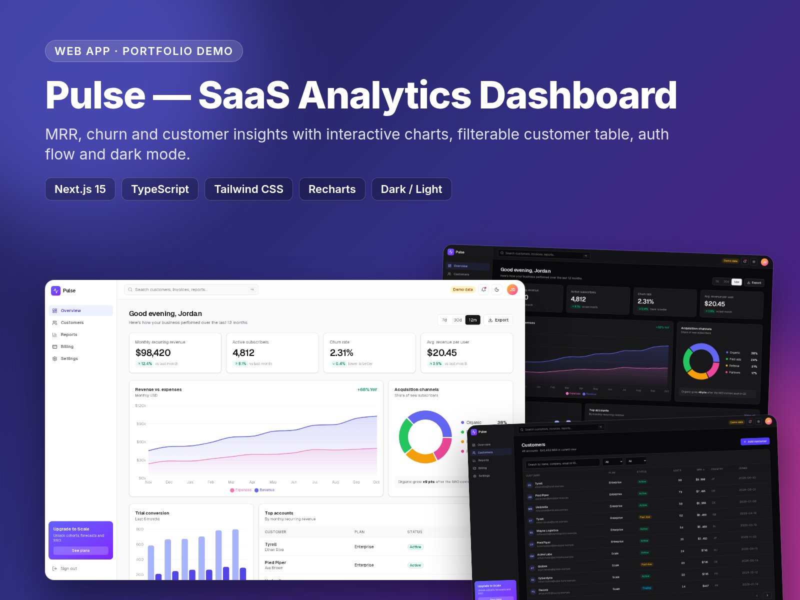
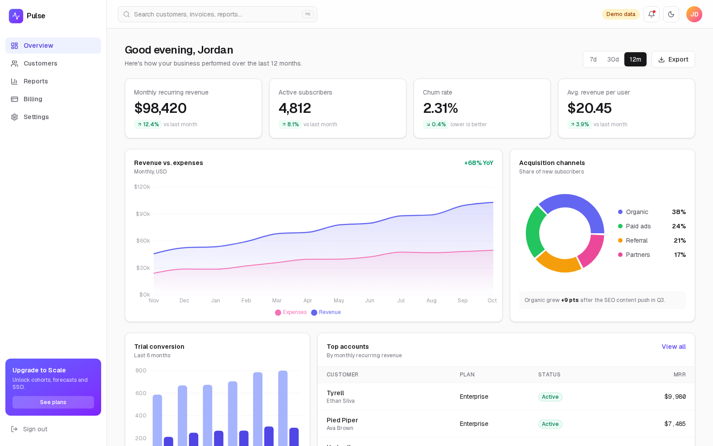
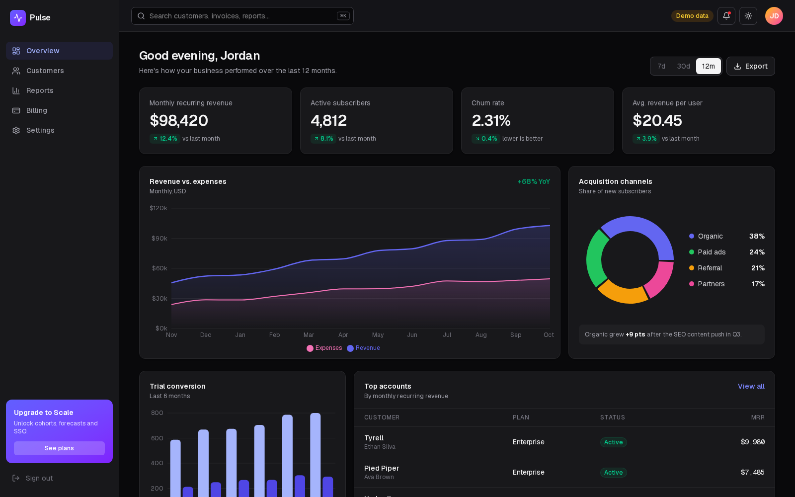
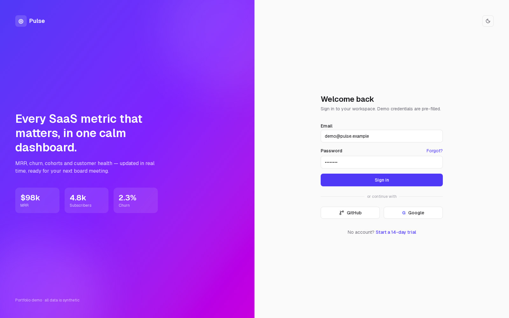
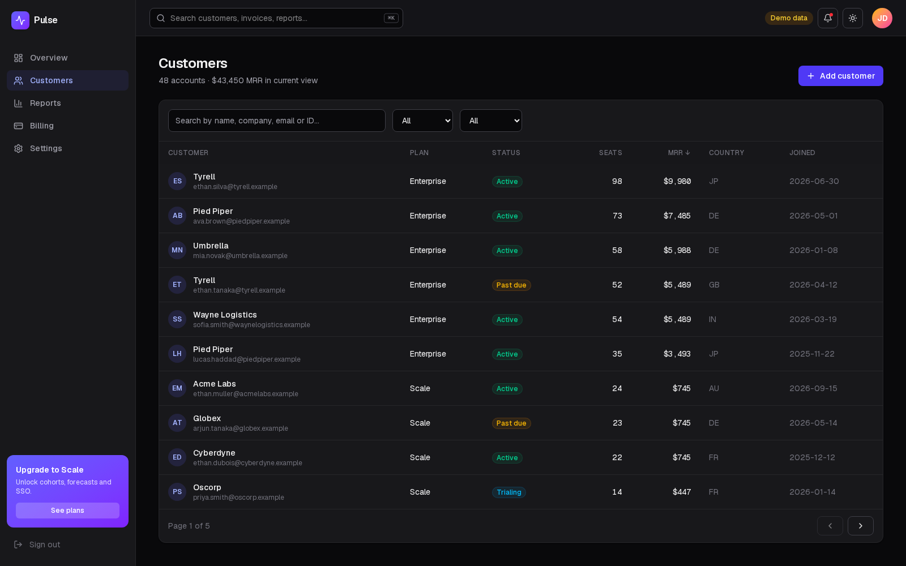

# Pulse — SaaS Analytics Dashboard

A polished, responsive analytics dashboard for a subscription (SaaS) business: MRR, churn, trial conversion, acquisition channels and a searchable customer table, with a login flow and dark/light mode.

**Live demo:** https://huynhduydong.github.io/nextjs-saas-dashboard/ (demo credentials are pre-filled — just click *Sign in*)

> Portfolio demo. All numbers, companies and people are synthetic, generated from a fixed seed in `src/lib/data.ts`. The login is a front-end demo (cookie flag), not real authentication.



## Features

- **Overview** — KPI cards with deltas, revenue vs. expenses area chart, trial-conversion bar chart, acquisition-channel donut, top accounts and activity feed
- **Customers** — instant search, status/plan filters, sortable columns, pagination, MRR total for the current view
- **Auth-style login** — split-screen login with validation, loading state and social buttons; dashboard routes guarded client-side
- **Dark / light theme** — `next-themes`, charts re-colour with the theme
- **Reusable UI kit** — shadcn-style `Card`, `Button`, `Input`, `Badge` components built on Tailwind
- **Static export** — deploys to GitHub Pages via GitHub Actions (`output: "export"`, configurable `BASE_PATH`)

## Stack

Next.js 15 (App Router) · React 19 · TypeScript · Tailwind CSS v4 · Recharts · lucide-react · next-themes · GitHub Actions / Pages

## Project structure

```
src/
  app/
    login/              # login screen
    dashboard/          # overview, customers, settings (+ shared layout)
  components/
    charts.tsx          # Recharts wrappers (theme-aware)
    shell.tsx           # sidebar + top bar
    ui.tsx              # Card, Button, Input, Badge
  lib/data.ts           # seeded synthetic dataset
```

## Run locally

```bash
npm install
npm run dev        # http://localhost:3000
npm run build      # static site in ./out
```

## Screenshots

| Overview (light) | Overview (dark) |
| --- | --- |
|  |  |

| Login | Customers |
| --- | --- |
|  |  |

## License

MIT © Huynh Duy Dong
